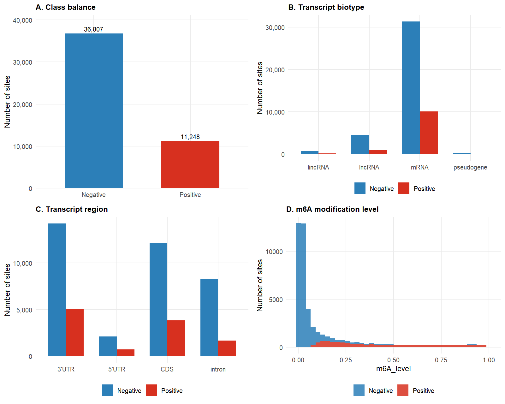
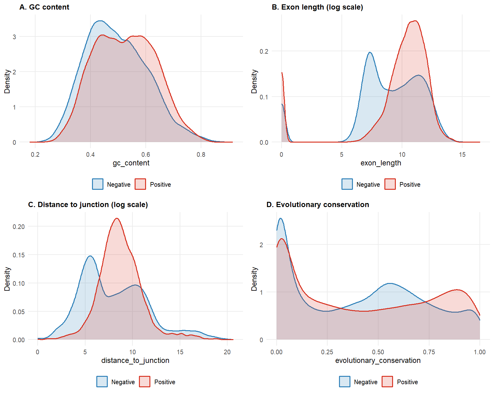
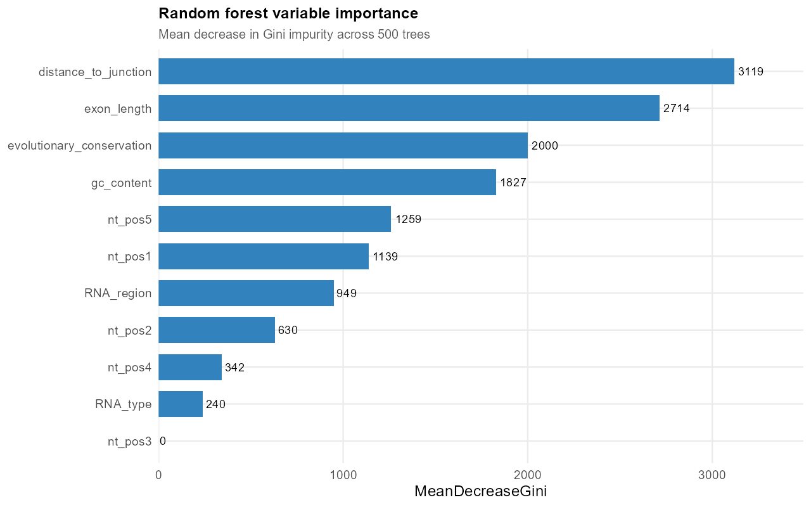
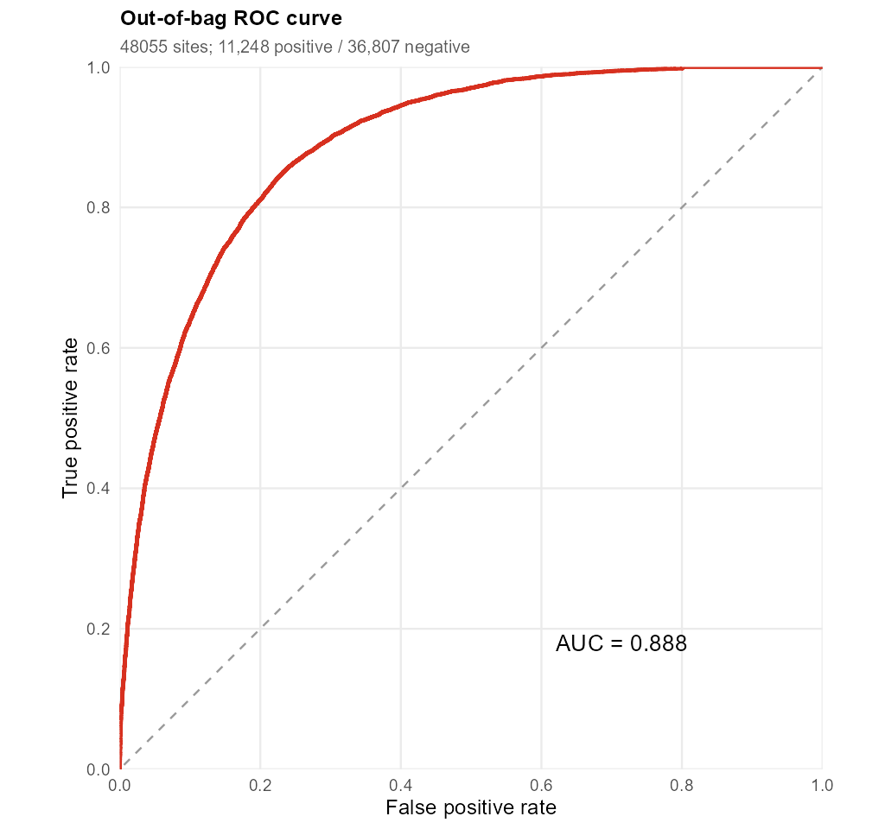
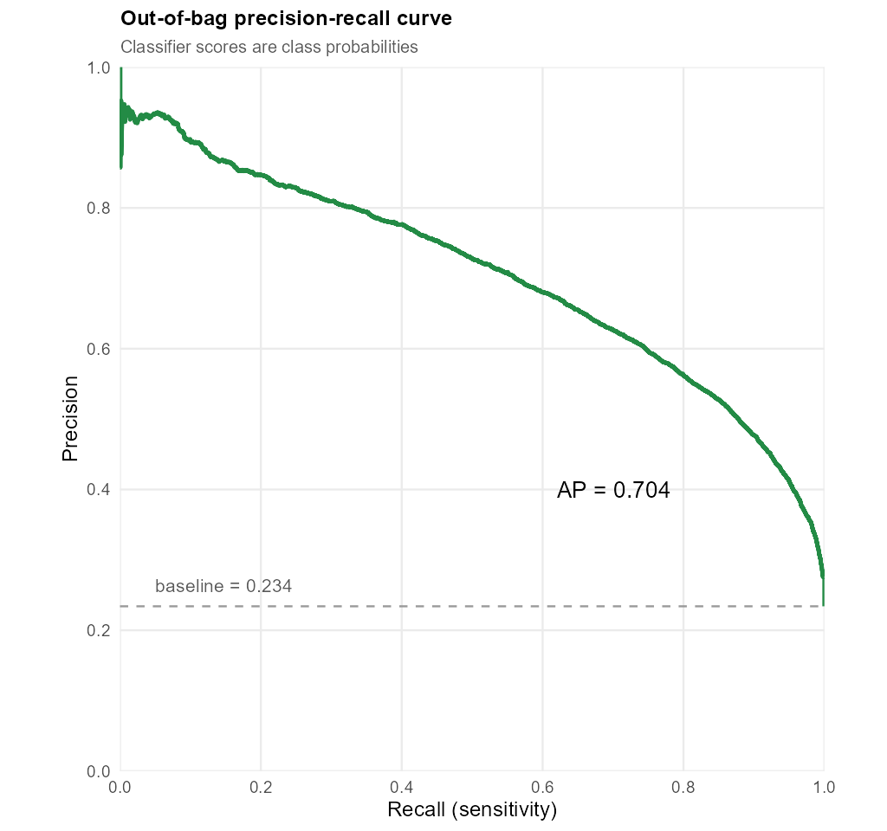
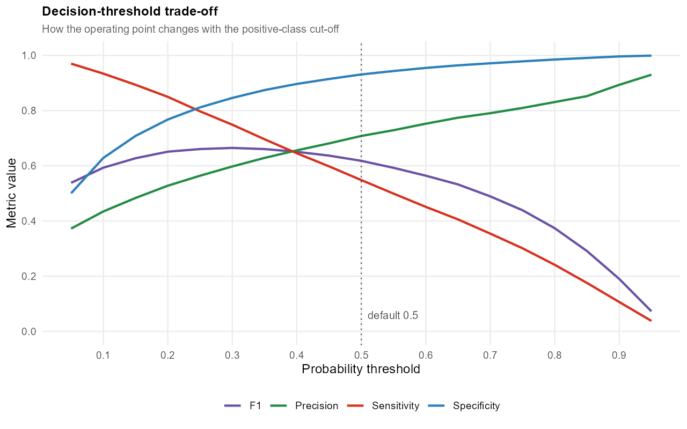
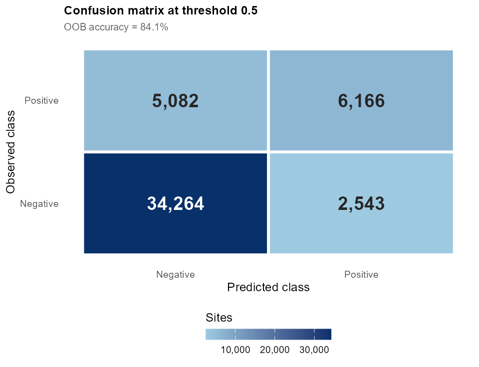
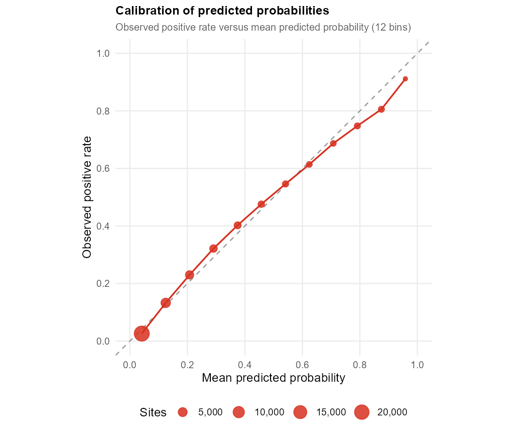

```{r setup, include=FALSE}
knitr::opts_chunk$set(
  echo = FALSE, message = FALSE, warning = FALSE,
  fig.align = "center", comment = "#>"
)
suppressPackageStartupMessages(library(knitr))
```

```{r analysis-data, include=FALSE}
# Everything below is derived from files shipped in data-raw/, so the report
# can be rebuilt without installing the package.
dat <- read.csv("data-raw/m6A_imbalanced.csv", stringsAsFactors = FALSE)
dat$m6A_status <- factor(dat$m6A_status, levels = c("Negative", "Positive"))

oob <- readRDS("data-raw/oob_predictions.rds")
oob$truth <- factor(oob$truth, levels = c("Negative", "Positive"))
truth_pos <- oob$truth == "Positive"
p <- oob$prob_positive
n_pos <- sum(truth_pos)
n_neg <- sum(!truth_pos)

ord <- order(p, decreasing = TRUE)
tp <- cumsum(truth_pos[ord])
fp <- cumsum(!truth_pos[ord])
tpr <- tp / n_pos
fpr <- fp / n_neg
prec <- tp / (tp + fp)
rec <- tpr
auc <- sum(diff(c(0, fpr)) * (c(0, tpr)[-1] + c(0, tpr)[-length(c(0, tpr))]) / 2)
ap <- sum(diff(c(0, rec)) * prec)

thresholds <- seq(0.05, 0.95, by = 0.05)
sweep <- do.call(rbind, lapply(thresholds, function(th) {
  pred_pos <- p > th
  TP <- sum(pred_pos & truth_pos);  FP <- sum(pred_pos & !truth_pos)
  TN <- sum(!pred_pos & !truth_pos); FN <- sum(!pred_pos & truth_pos)
  data.frame(threshold = th, TP = TP, FP = FP, TN = TN, FN = FN,
             sensitivity = TP / (TP + FN),
             specificity = TN / (TN + FP),
             precision   = ifelse(TP + FP == 0, NA, TP / (TP + FP)),
             accuracy    = (TP + TN) / length(p),
             f1          = ifelse(TP + FP == 0, NA, 2 * TP / (2 * TP + FP + FN)),
             predicted_positive = sum(pred_pos))
}))
cm <- sweep[sweep$threshold == 0.5, ]
best_f1 <- sweep[which.max(sweep$f1), ]
```

# Overview

**m6APrediction** is an R package that predicts whether a candidate adenosine in
the human transcriptome is an N6-methyladenosine (m6A) site. It wraps a random
forest classifier trained on 48,055 experimentally characterised m6A sites and
exposes two user-facing functions:

* `prediction_single()` — score one site from its feature values;
* `prediction_multiple()` — score a table of sites and return the input table
  with a probability and a class label appended.

The package bundles the fitted model and a small example input table, so it works
offline immediately after installation. This README doubles as the analysis
report for the model: it documents the data, the encoding and training
procedure, the out-of-bag performance of the classifier, and the practical
consequences of choosing a decision threshold.

## At a glance

| Item | Value |
|---|---|
| Task | Binary classification of candidate adenosines (m6A vs. not m6A) |
| Algorithm | Random forest (`randomForest` 4.7-x), 500 trees, `mtry = 3` |
| Training sites | `r format(nrow(dat), big.mark = ",")` human sites |
| Class balance | `r format(sum(dat$m6A_status == "Positive"), big.mark = ",")` positive / `r format(sum(dat$m6A_status == "Negative"), big.mark = ",")` negative (`r sprintf("%.1f", 100 * mean(dat$m6A_status == "Positive"))`% prevalence) |
| Predictors | 6 numeric or categorical features + 5 encoded nucleotide positions |
| Out-of-bag AUC | `r sprintf("%.3f", auc)` |
| Out-of-bag average precision | `r sprintf("%.3f", ap)` |
| Default decision threshold | 0.5 |

# Installation

The package requires R version 3.5.0 or newer and `randomForest`. `ggplot2`, `knitr`,
`rmarkdown`, `scales` and `testthat` are only needed to rebuild this report and
to run the test suite.

```{r install, eval=FALSE, echo=TRUE}
# From a source tarball
install.packages("m6APrediction_1.0.0.tar.gz", repos = NULL, type = "source")

# From a local source directory
install.packages("m6APrediction", repos = NULL, type = "source")

# From GitHub, once the repository is published
# remotes::install_github("your-github-username/m6APrediction")

library(m6APrediction)
```

# Quick start

## One site

```{r quick-single, eval=FALSE, echo=TRUE}
library(m6APrediction)

prediction_single(
  gc_content = 0.65,
  RNA_type = "mRNA",
  RNA_region = "CDS",
  exon_length = 10.63,
  distance_to_junction = 7.66,
  evolutionary_conservation = 0.18,
  DNA_5mer = "GGACA"
)
#> predicted_m6A_prob predicted_m6A_status
#>             "0.932"           "Positive"
```

`prediction_single()` returns a named character vector. The probability is the
random forest vote for the positive class; the status is that probability
thresholded at `positive_threshold` (0.5 by default).

## A table of sites

```{r quick-batch, eval=FALSE, echo=TRUE}
example_csv <- system.file("extdata", "m6A_input_example.csv",
                           package = "m6APrediction")
sites <- read.csv(example_csv)

scored <- prediction_multiple(feature_df = sites, positive_threshold = 0.5)
head(scored[, c("DNA_5mer", "predicted_m6A_prob", "predicted_m6A_status")], 3)
#>   DNA_5mer predicted_m6A_prob predicted_m6A_status
#> 1    GGACC              0.610             Positive
#> 2    TGACC              0.014             Negative
#> 3    GAACA              0.180             Negative
```

The input table must contain the seven feature columns described below; extra
columns are preserved. The returned table adds `predicted_m6A_prob` and
`predicted_m6A_status`.

# Data

The training set contains `r format(nrow(dat), big.mark = ",")` m6A sites from
the human transcriptome. Each site is described by 16 variables: 7 model
features plus identifiers, coverage summaries and the quantitative modification
level used to derive the label.

```{r variable-table, results='asis'}
var_info <- data.frame(
  Variable = c("chromosome", "start", "end", "width", "strand", "m6A_status",
               "m6A_coverage", "total_coverage", "m6A_level", "gc_content",
               "DNA_5mer", "RNA_type", "RNA_region", "exon_length",
               "distance_to_junction", "evolutionary_conservation"),
  Role = c(rep("Identifier / annotation", 5), "Label", "Coverage", "Coverage",
           "Label source", "Predictor", "Predictor", "Predictor", "Predictor",
           "Predictor", "Predictor", "Predictor"),
  Type = c("character", "integer", "integer", "integer", "character",
           "character", "integer", "integer", "numeric", "numeric",
           "character", "character", "character", "numeric", "numeric",
           "numeric"),
  Description = c(
    "Reference chromosome",
    "Genomic start of the site",
    "Genomic end of the site",
    "Genomic width of the site",
    "Genomic strand (+/-)",
    "Modification label (Positive / Negative)",
    "Reads supporting the modification",
    "Total reads at the locus",
    "Quantitative modification level (0-1)",
    "GC content of the local sequence (0-1)",
    "DNA 5-mer centred on the candidate adenosine",
    "Transcript biotype",
    "Transcript region",
    "Host exon length (log-transformed units)",
    "Distance to the nearest splice junction (log-transformed units)",
    "Cross-species evolutionary conservation (0-1)"
  )
)
kable(var_info, align = c("l", "l", "l", "l"),
      caption = "Variables in the m6A training table.")
```

Only the seven rows marked *Predictor* enter the model. The label is derived
from `m6A_status`; `m6A_level`, coverage columns and genomic coordinates are
descriptive and are deliberately excluded to avoid label leakage.

## Class balance and composition

```{r fig-overview, fig.cap="Dataset overview. (A) Class balance. (B) Transcript biotype. (C) Transcript region. (D) Distribution of the quantitative m6A level.", out.width="100%"}

```

The classes are imbalanced: only `r sprintf("%.1f", 100 * mean(dat$m6A_status == "Positive"))`%
of sites are positive. Most sites lie on mRNA (86.1%) and in 3'UTRs (40.2%) or
CDS regions (33.2%). Positivity is not uniform across annotations
(`r sprintf("%.1f", 100 * prop.table(table(dat$RNA_region, dat$m6A_status), 1)["3'UTR", "Positive"])`%
in 3'UTRs versus
`r sprintf("%.1f", 100 * prop.table(table(dat$RNA_region, dat$m6A_status), 1)["intron", "Positive"])`%
in introns), which is why region and biotype are useful predictors.

```{r composition-table, results='asis'}
comp <- rbind(
  data.frame(Annotation = "RNA_type", Level = names(table(dat$RNA_type)),
             Sites = format(as.integer(table(dat$RNA_type)), big.mark = ","),
             Positive = sprintf("%.1f%%", 100 * prop.table(table(dat$RNA_type, dat$m6A_status), 1)[, "Positive"])),
  data.frame(Annotation = "RNA_region", Level = names(table(dat$RNA_region)),
             Sites = format(as.integer(table(dat$RNA_region)), big.mark = ","),
             Positive = sprintf("%.1f%%", 100 * prop.table(table(dat$RNA_region, dat$m6A_status), 1)[, "Positive"]))
)
kable(comp, align = c("l", "l", "r", "r"),
      caption = "Sites per annotation level and the positive rate within each level.")
```

# Methods

## Feature encoding

The seven input features are:

1. `gc_content` — GC content of the local sequence;
2. `RNA_type` — mRNA, lincRNA, lncRNA or pseudogene;
3. `RNA_region` — CDS, intron, 3'UTR or 5'UTR;
4. `exon_length` — host exon length on the log scale used during training;
5. `distance_to_junction` — distance to the nearest splice junction, log scale;
6. `evolutionary_conservation` — conservation score between 0 and 1;
7. `DNA_5mer` — the five nucleotides centred on the candidate adenosine.

`dna_encoding()` splits the 5-mer into five categorical columns
(`nt_pos1`–`nt_pos5`, levels A/T/C/G). The two prediction functions call it
internally, so users supply the sequence as a single string.

Because m6A is deposited on a specific adenosine, the centre position of every
training 5-mer is A; the encoder enforces this and converts U to T. This has a
visible consequence in the importance ranking: `nt_pos3` is constant in the
training data and therefore carries zero information, while the flanking
positions contribute substantially.

## Model and evaluation

The bundled model is a random forest with 500 trees and `mtry = 3`, fitted to
the 48,055 sites with `randomForest` using `importance = TRUE`. Performance is
estimated **out-of-bag (OOB)**: every site is predicted only by the trees that
did not see it during training, which gives an honest estimate without a
separate hold-out set.

Reported metrics:

* **AUC** — area under the receiver operating characteristic curve;
* **Average precision (AP)** — area under the precision-recall curve, a more
  informative summary than AUC when the positive class is rare;
* **Sensitivity / specificity** — recall on positives / recall on negatives at a
  fixed threshold;
* **Precision** — proportion of predicted positives that are truly positive;
* **F1** — harmonic mean of precision and sensitivity;
* **Calibration** — agreement between predicted probabilities and observed
  positive rates.

The OOB probabilities were exported once from the fitted model
(`data-raw/prepare_oob.R`) and all metrics below are computed from that file by
`data-raw/make_figures.R`.

# Results

## Feature distributions by class

```{r fig-features, fig.cap="Distributions of the four continuous predictors, split by observed class.", out.width="100%"}

```

```{r median-table, results='asis'}
med <- aggregate(
  dat[, c("gc_content", "exon_length", "distance_to_junction",
          "evolutionary_conservation")],
  by = list(Status = dat$m6A_status), FUN = median
)
med[, -1] <- round(med[, -1], 2)
kable(med, align = c("l", "r", "r", "r", "r"),
      caption = "Median predictor values in the two classes.")
```

Positive sites tend to have higher GC content, longer exons, a larger distance
to the nearest splice junction and higher evolutionary conservation. The
separation is modest for any single feature, but the four effects are
consistent, and the random forest combines them with the sequence and
annotation features.

## Variable importance

```{r fig-importance, fig.cap="Random forest variable importance (mean decrease in Gini impurity).", out.width="85%"}

```

Transcript architecture dominates: `distance_to_junction` and `exon_length` are
the two most important variables, followed by conservation and GC content. The
sequence positions flanking the adenosine (`nt_pos1`, `nt_pos5`) add
information beyond the aggregate GC content, consistent with the DRACH-like
motif context of m6A. `RNA_type` is the least important predictor, largely
because most sites are on mRNA and the remaining biotypes are rare.

## Discrimination: ROC and precision-recall

```{r fig-roc, fig.cap="Out-of-bag ROC curve.", out.width="62%"}

```

```{r fig-prc, fig.cap="Out-of-bag precision-recall curve. The dashed line is the positive-class prevalence (0.234).", out.width="62%"}

```

The classifier reaches an OOB AUC of `r sprintf("%.3f", auc)`. Because the
positive class is a minority, the precision-recall view is the more relevant
one: average precision is `r sprintf("%.3f", ap)` against a baseline of
`r sprintf("%.3f", mean(truth_pos))`, so the model enriches true m6A sites by
roughly a factor of `r sprintf("%.1f", ap / mean(truth_pos))` relative to random
selection across the recall range.

## Choosing an operating threshold

```{r fig-threshold, fig.cap="Sensitivity, specificity, precision and F1 as a function of the positive-class probability threshold.", out.width="85%"}

```

```{r threshold-table, results='asis'}
show <- sweep[round(sweep$threshold, 2) %in% c(0.30, 0.40, 0.50, 0.60, 0.70), ]
show <- show[, c("threshold", "sensitivity", "specificity", "precision",
                 "accuracy", "f1", "predicted_positive")]
show[, 2:6] <- round(show[, 2:6], 3)
show$threshold <- sprintf("%.2f", show$threshold)
show$predicted_positive <- format(show$predicted_positive, big.mark = ",")
kable(show, row.names = FALSE,
      align = c("r", "r", "r", "r", "r", "r", "r"),
      col.names = c("Threshold", "Sensitivity", "Specificity", "Precision",
                    "Accuracy", "F1", "Predicted positive"),
      caption = "Operating characteristics at selected thresholds.")
```

The default 0.5 favours specificity: it labels
`r format(cm$TP + cm$FP, big.mark = ",")` sites as positive, of which
`r format(cm$TP, big.mark = ",")` are true positives
(precision `r sprintf("%.1f%%", 100 * cm$precision)`), but it misses
`r format(cm$FN, big.mark = ",")` true sites (sensitivity
`r sprintf("%.1f%%", 100 * cm$sensitivity)`). Lowering the threshold to 0.30
raises sensitivity to `r sprintf("%.1f%%", 100 * best_f1$sensitivity)` and F1 to
`r sprintf("%.3f", best_f1$f1)`, at the cost of many more false positives. The
right choice depends on the downstream cost of a false negative versus a false
positive; `positive_threshold` exposes this decision to the user.

```{r fig-confusion, fig.cap="Confusion matrix at the default threshold of 0.5.", out.width="62%"}

```

## Calibration

```{r fig-calibration, fig.cap="Calibration plot: observed positive rate against mean predicted probability in 12 probability bins.", out.width="62%"}

```

Probabilities are close to the diagonal, with mild over-confidence at the high
end (the top bin predicts about 0.96 but observes about 0.91). For ranking and
thresholding this is acceptable; for applications that interpret the number
itself as a calibrated risk, a small recalibration step would be advisable.

## Performance summary

```{r summary-table, results='asis'}
perf <- data.frame(
  Metric = c("AUC", "Average precision", "Baseline prevalence", "Accuracy",
             "Sensitivity", "Specificity", "Precision", "F1"),
  Value = c(sprintf("%.3f", auc), sprintf("%.3f", ap),
            sprintf("%.3f", mean(truth_pos)), sprintf("%.1f%%", 100 * cm$accuracy),
            sprintf("%.1f%%", 100 * cm$sensitivity),
            sprintf("%.1f%%", 100 * cm$specificity),
            sprintf("%.1f%%", 100 * cm$precision), sprintf("%.3f", cm$f1))
)
kable(perf, align = c("l", "r"),
      caption = "Out-of-bag performance at the default 0.5 threshold (AUC and AP are threshold-free).")
```

# Discussion

The model recovers the main known correlates of m6A: sites are enriched in long
exons, in 3'UTRs and CDS regions, in GC-rich and evolutionarily conserved
sequence, and away from splice junctions. The strong importance of
`distance_to_junction` and `exon_length` suggests that the classifier is partly
learning where in a transcript m6A tends to occur rather than a purely
sequence-specific code, which is consistent with the current understanding of
m6A deposition.

Limitations to keep in mind:

* **Imbalance.** At the default threshold the model is conservative; recall is
  only `r sprintf("%.1f%%", 100 * cm$sensitivity)`. Users interested in
  candidate discovery should lower the threshold or rank by probability.
* **Training distribution.** The model was trained on human sites with the
  feature definitions used in this course. Applying it to another species, to
  raw base-pair exon lengths, or to 5-mers that do not have A at the centre is
  outside its intended use.
* **No external validation.** All metrics are out-of-bag on the training
  distribution. An independent experimental set would be needed to claim
  generalisation.
* **Correlated predictors.** Gini importance favours variables that are used
  often and can split the credit between correlated features; it should be read
  as a description of this forest, not as a causal ranking.
* **Label provenance.** The positive/negative labels derive from the provided
  `m6A_status` column; the model inherits any noise in those labels.

# Reproducibility

| Script | Purpose |
|---|---|
| `data-raw/prepare_oob.R` | Exports OOB probabilities from the fitted model |
| `data-raw/make_figures.R` | Rebuilds every figure and every number in this report |
| `tests/testthat/test-predict.R` | Unit tests for encoding, prediction and input validation |

```{r session, echo=FALSE, results='asis'}
si <- sessionInfo()
pkgs <- c("R" = as.character(getRversion()),
          "randomForest" = as.character(packageVersion("randomForest")),
          "ggplot2" = as.character(packageVersion("ggplot2")),
          "knitr" = as.character(packageVersion("knitr")),
          "rmarkdown" = as.character(packageVersion("rmarkdown")))
kable(data.frame(Component = names(pkgs), Version = unname(pkgs)),
      align = c("l", "l"), caption = "Software used to build this report.")
```

The package itself was checked with `R CMD check --no-manual` (R 4.5.0,
Windows 11); the current status is documented in the build log. To rebuild the
report from a clean checkout:

```{r rebuild, eval=FALSE, echo=TRUE}
Rscript data-raw/make_figures.R
rmarkdown::render("README.Rmd")
```

# Package structure

```
m6APrediction/
├── DESCRIPTION            package metadata and dependencies
├── NAMESPACE              exported functions and imports
├── LICENSE
├── R/
│   └── main.R             dna_encoding(), prediction_multiple(), prediction_single()
├── man/                   Rd help pages and report figures
├── inst/extdata/
│   ├── rf_fit.rds         fitted random forest (13.4 MB)
│   └── m6A_input_example.csv
├── tests/testthat/        unit tests
├── data-raw/              training data, OOB predictions, figure scripts
├── README.Rmd             source of this report
└── README.md              rendered report
```

# Documentation

Every exported function has a help page with runnable examples:

```{r help, eval=FALSE, echo=TRUE}
?prediction_single
?prediction_multiple
```

# References

1. Breiman L. Random Forests. *Machine Learning* 45, 5–32 (2001).
2. Liaw A, Wiener M. Classification and Regression by randomForest.
   *R News* 2(3), 18–22 (2002).
3. Dominissini D et al. Topology of the human and mouse m6A RNA methylomes
   revealed by m1A-seq. *Nature* 485, 201–206 (2012).
4. Meyer KD et al. Comprehensive analysis of mRNA methylation reveals enrichment
   in 3' UTRs and near stop codons. *Cell* 149, 1635–1646 (2012).
5. Wickham H, Bryan J. *R Packages* (2nd edition). O'Reilly, 2023.

# License

MIT © the package authors. See `LICENSE`.
