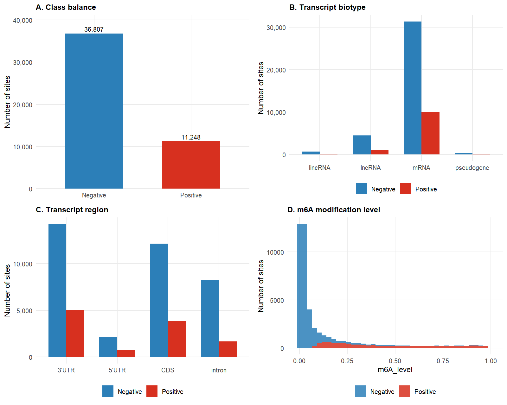
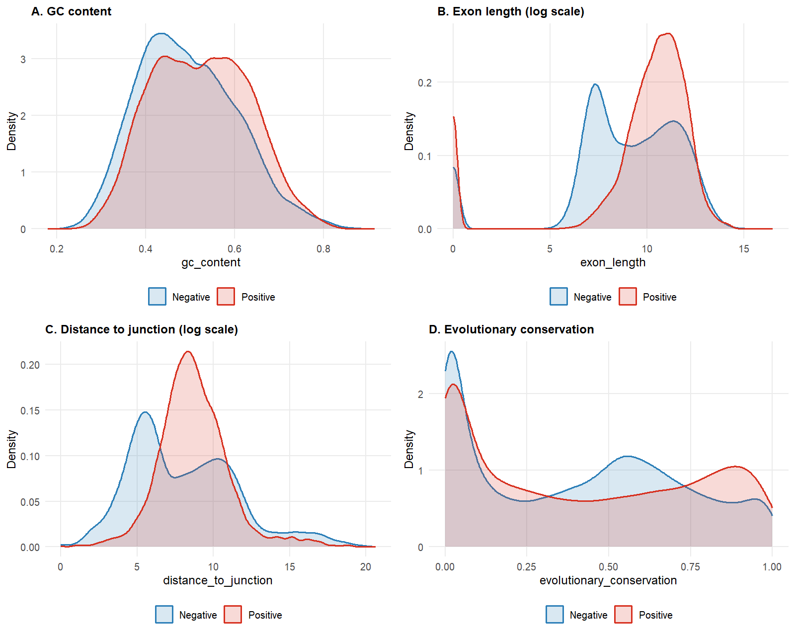
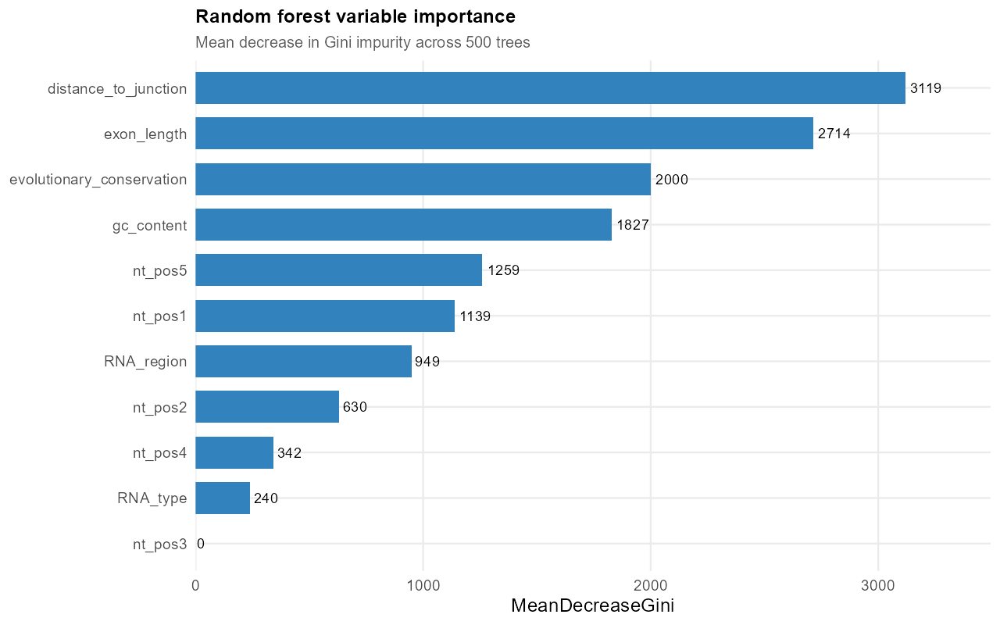
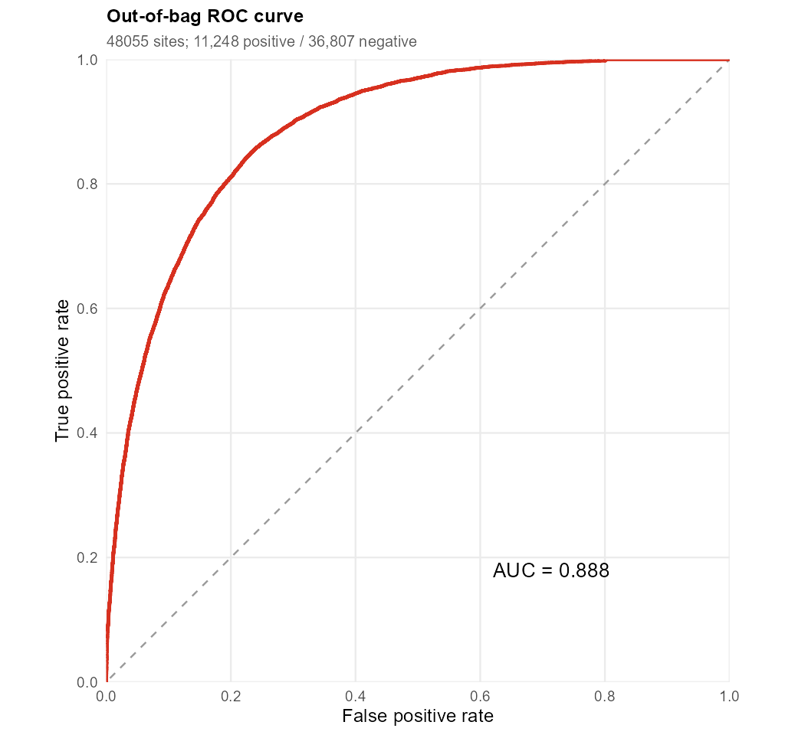
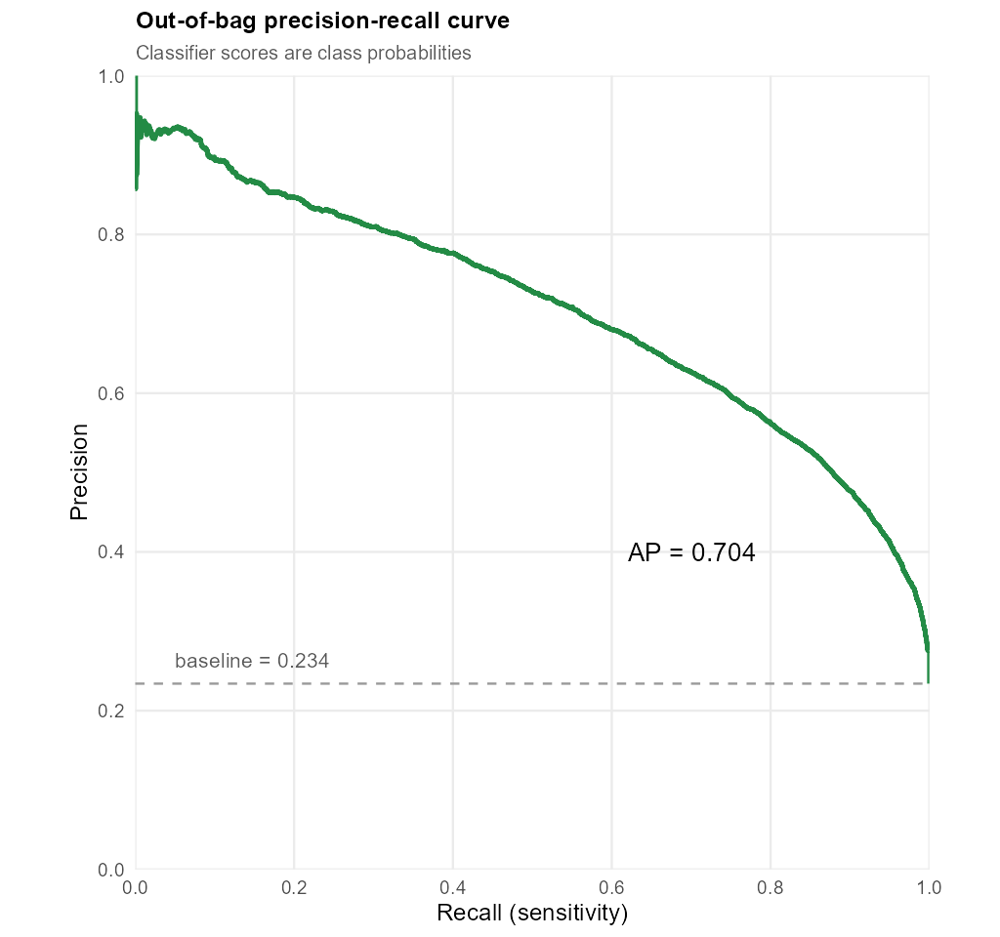
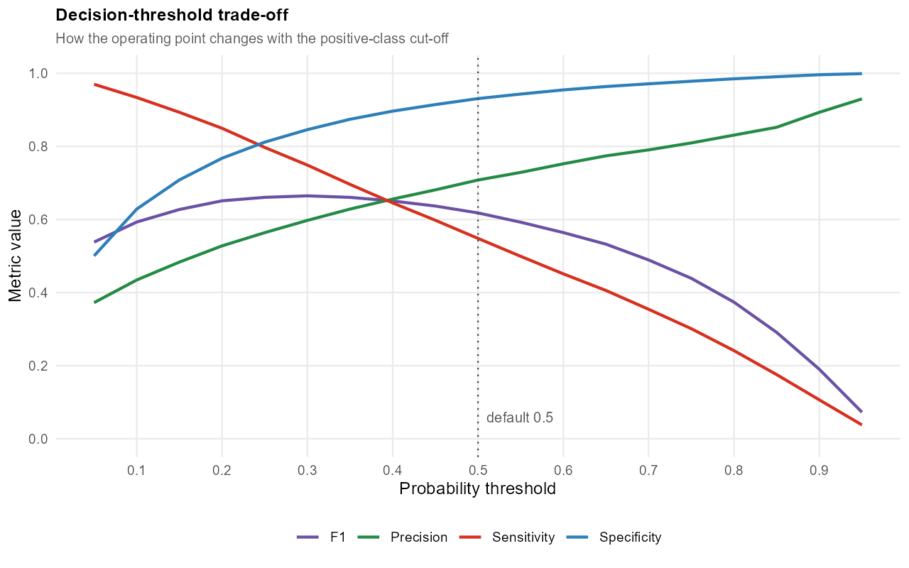
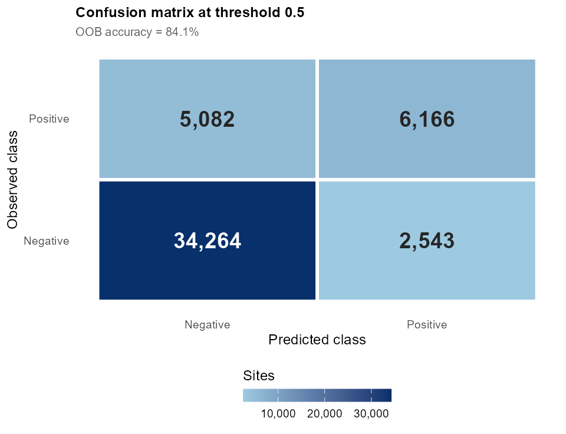
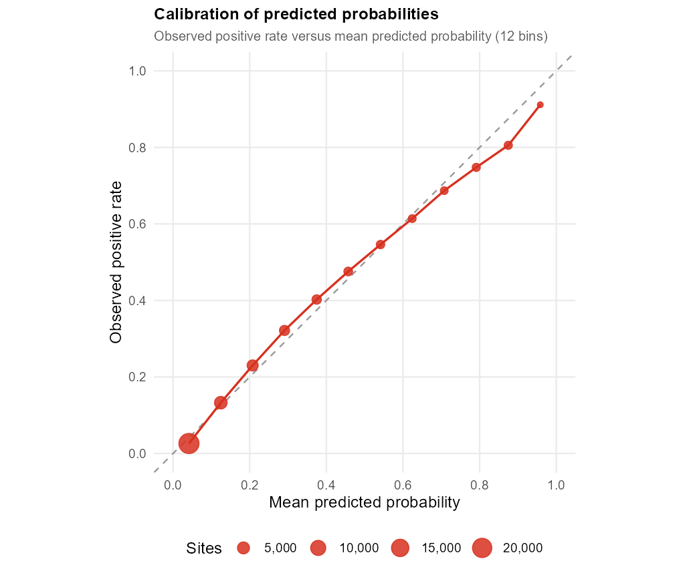

m6APrediction: predicting m6A RNA modification sites with a random
forest
================
BIO215 student
13 November 2026

-   [Overview](#overview)
    -   [At a glance](#at-a-glance)
-   [Installation](#installation)
-   [Quick start](#quick-start)
    -   [One site](#one-site)
    -   [A table of sites](#a-table-of-sites)
-   [Data](#data)
    -   [Class balance and composition](#class-balance-and-composition)
-   [Methods](#methods)
    -   [Feature encoding](#feature-encoding)
    -   [Model and evaluation](#model-and-evaluation)
-   [Results](#results)
    -   [Feature distributions by
        class](#feature-distributions-by-class)
    -   [Variable importance](#variable-importance)
    -   [Discrimination: ROC and
        precision-recall](#discrimination-roc-and-precision-recall)
    -   [Choosing an operating
        threshold](#choosing-an-operating-threshold)
    -   [Calibration](#calibration)
    -   [Performance summary](#performance-summary)
-   [Discussion](#discussion)
-   [Reproducibility](#reproducibility)
-   [Package structure](#package-structure)
-   [Documentation](#documentation)
-   [References](#references)
-   [License](#license)

# Overview

**m6APrediction** is an R package that predicts whether a candidate
adenosine in the human transcriptome is an N6-methyladenosine (m6A)
site. It wraps a random forest classifier trained on 48,055
experimentally characterised m6A sites and exposes two user-facing
functions:

-   `prediction_single()` — score one site from its feature values;
-   `prediction_multiple()` — score a table of sites and return the
    input table with a probability and a class label appended.

The package bundles the fitted model and a small example input table, so
it works offline immediately after installation. This README doubles as
the analysis report for the model: it documents the data, the encoding
and training procedure, the out-of-bag performance of the classifier,
and the practical consequences of choosing a decision threshold.

## At a glance

| Item                         | Value                                                              |
|------------------------------|--------------------------------------------------------------------|
| Task                         | Binary classification of candidate adenosines (m6A vs. not m6A)    |
| Algorithm                    | Random forest (`randomForest` 4.7-x), 500 trees, `mtry = 3`        |
| Training sites               | 48,055 human sites                                                 |
| Class balance                | 11,248 positive / 36,807 negative (23.4% prevalence)               |
| Predictors                   | 6 numeric or categorical features + 5 encoded nucleotide positions |
| Out-of-bag AUC               | 0.888                                                              |
| Out-of-bag average precision | 0.704                                                              |
| Default decision threshold   | 0.5                                                                |

# Installation

The package requires R version 3.5.0 or newer and `randomForest`.
`ggplot2`, `knitr`, `rmarkdown`, `scales` and `testthat` are only needed
to rebuild this report and to run the test suite.

``` r
# From a source tarball
install.packages("m6APrediction_1.0.0.tar.gz", repos = NULL, type = "source")

# From a local source directory
install.packages("m6APrediction", repos = NULL, type = "source")

# From GitHub, once the repository is published
# remotes::install_github("your-github-username/m6APrediction")

library(m6APrediction)
```

# Quick start

## One site

``` r
library(m6APrediction)

prediction_single(
  gc_content = 0.65,
  RNA_type = "mRNA",
  RNA_region = "CDS",
  exon_length = 10.63,
  distance_to_junction = 7.66,
  evolutionary_conservation = 0.18,
  DNA_5mer = "GGACA"
)
#> predicted_m6A_prob predicted_m6A_status
#>             "0.932"           "Positive"
```

`prediction_single()` returns a named character vector. The probability
is the random forest vote for the positive class; the status is that
probability thresholded at `positive_threshold` (0.5 by default).

## A table of sites

``` r
example_csv <- system.file("extdata", "m6A_input_example.csv",
                           package = "m6APrediction")
sites <- read.csv(example_csv)

scored <- prediction_multiple(feature_df = sites, positive_threshold = 0.5)
head(scored[, c("DNA_5mer", "predicted_m6A_prob", "predicted_m6A_status")], 3)
#>   DNA_5mer predicted_m6A_prob predicted_m6A_status
#> 1    GGACC              0.610             Positive
#> 2    TGACC              0.014             Negative
#> 3    GAACA              0.180             Negative
```

The input table must contain the seven feature columns described below;
extra columns are preserved. The returned table adds
`predicted_m6A_prob` and `predicted_m6A_status`.

# Data

The training set contains 48,055 m6A sites from the human transcriptome.
Each site is described by 16 variables: 7 model features plus
identifiers, coverage summaries and the quantitative modification level
used to derive the label.

| Variable                   | Role                    | Type      | Description                                                     |
|:---------------------------|:------------------------|:----------|:----------------------------------------------------------------|
| chromosome                 | Identifier / annotation | character | Reference chromosome                                            |
| start                      | Identifier / annotation | integer   | Genomic start of the site                                       |
| end                        | Identifier / annotation | integer   | Genomic end of the site                                         |
| width                      | Identifier / annotation | integer   | Genomic width of the site                                       |
| strand                     | Identifier / annotation | character | Genomic strand (+/-)                                            |
| m6A\_status                | Label                   | character | Modification label (Positive / Negative)                        |
| m6A\_coverage              | Coverage                | integer   | Reads supporting the modification                               |
| total\_coverage            | Coverage                | integer   | Total reads at the locus                                        |
| m6A\_level                 | Label source            | numeric   | Quantitative modification level (0-1)                           |
| gc\_content                | Predictor               | numeric   | GC content of the local sequence (0-1)                          |
| DNA\_5mer                  | Predictor               | character | DNA 5-mer centred on the candidate adenosine                    |
| RNA\_type                  | Predictor               | character | Transcript biotype                                              |
| RNA\_region                | Predictor               | character | Transcript region                                               |
| exon\_length               | Predictor               | numeric   | Host exon length (log-transformed units)                        |
| distance\_to\_junction     | Predictor               | numeric   | Distance to the nearest splice junction (log-transformed units) |
| evolutionary\_conservation | Predictor               | numeric   | Cross-species evolutionary conservation (0-1)                   |

Variables in the m6A training table.

Only the seven rows marked *Predictor* enter the model. The label is
derived from `m6A_status`; `m6A_level`, coverage columns and genomic
coordinates are descriptive and are deliberately excluded to avoid label
leakage.

## Class balance and composition

<div class="figure" style="text-align: center">


<p class="caption">
Dataset overview. (A) Class balance. (B) Transcript biotype. (C)
Transcript region. (D) Distribution of the quantitative m6A level.
</p>

</div>

The classes are imbalanced: only 23.4% of sites are positive. Most sites
lie on mRNA (86.1%) and in 3’UTRs (40.2%) or CDS regions (33.2%).
Positivity is not uniform across annotations (26.1% in 3’UTRs versus
16.8% in introns), which is why region and biotype are useful
predictors.

| Annotation  | Level      |  Sites | Positive |
|:------------|:-----------|-------:|---------:|
| RNA\_type   | lincRNA    |    869 |    20.5% |
| RNA\_type   | lncRNA     |  5,439 |    17.7% |
| RNA\_type   | mRNA       | 41,365 |    24.3% |
| RNA\_type   | pseudogene |    382 |    16.5% |
| RNA\_region | 3’UTR      | 19,307 |    26.1% |
| RNA\_region | 5’UTR      |  2,809 |    25.1% |
| RNA\_region | CDS        | 15,968 |    24.0% |
| RNA\_region | intron     |  9,971 |    16.8% |

Sites per annotation level and the positive rate within each level.

# Methods

## Feature encoding

The seven input features are:

1.  `gc_content` — GC content of the local sequence;
2.  `RNA_type` — mRNA, lincRNA, lncRNA or pseudogene;
3.  `RNA_region` — CDS, intron, 3’UTR or 5’UTR;
4.  `exon_length` — host exon length on the log scale used during
    training;
5.  `distance_to_junction` — distance to the nearest splice junction,
    log scale;
6.  `evolutionary_conservation` — conservation score between 0 and 1;
7.  `DNA_5mer` — the five nucleotides centred on the candidate
    adenosine.

`dna_encoding()` splits the 5-mer into five categorical columns
(`nt_pos1`–`nt_pos5`, levels A/T/C/G). The two prediction functions call
it internally, so users supply the sequence as a single string.

Because m6A is deposited on a specific adenosine, the centre position of
every training 5-mer is A; the encoder enforces this and converts U to
T. This has a visible consequence in the importance ranking: `nt_pos3`
is constant in the training data and therefore carries zero information,
while the flanking positions contribute substantially.

## Model and evaluation

The bundled model is a random forest with 500 trees and `mtry = 3`,
fitted to the 48,055 sites with `randomForest` using
`importance = TRUE`. Performance is estimated **out-of-bag (OOB)**:
every site is predicted only by the trees that did not see it during
training, which gives an honest estimate without a separate hold-out
set.

Reported metrics:

-   **AUC** — area under the receiver operating characteristic curve;
-   **Average precision (AP)** — area under the precision-recall curve,
    a more informative summary than AUC when the positive class is rare;
-   **Sensitivity / specificity** — recall on positives / recall on
    negatives at a fixed threshold;
-   **Precision** — proportion of predicted positives that are truly
    positive;
-   **F1** — harmonic mean of precision and sensitivity;
-   **Calibration** — agreement between predicted probabilities and
    observed positive rates.

The OOB probabilities were exported once from the fitted model
(`data-raw/prepare_oob.R`) and all metrics below are computed from that
file by `data-raw/make_figures.R`.

# Results

## Feature distributions by class

<div class="figure" style="text-align: center">


<p class="caption">
Distributions of the four continuous predictors, split by observed
class.
</p>

</div>

| Status   | gc\_content | exon\_length | distance\_to\_junction | evolutionary\_conservation |
|:---------|------------:|-------------:|-----------------------:|---------------------------:|
| Negative |        0.48 |         9.11 |                   7.52 |                       0.42 |
| Positive |        0.52 |        10.52 |                   8.55 |                       0.38 |

Median predictor values in the two classes.

Positive sites tend to have higher GC content, longer exons, a larger
distance to the nearest splice junction and higher evolutionary
conservation. The separation is modest for any single feature, but the
four effects are consistent, and the random forest combines them with
the sequence and annotation features.

## Variable importance

<div class="figure" style="text-align: center">


<p class="caption">
Random forest variable importance (mean decrease in Gini impurity).
</p>

</div>

Transcript architecture dominates: `distance_to_junction` and
`exon_length` are the two most important variables, followed by
conservation and GC content. The sequence positions flanking the
adenosine (`nt_pos1`, `nt_pos5`) add information beyond the aggregate GC
content, consistent with the DRACH-like motif context of m6A. `RNA_type`
is the least important predictor, largely because most sites are on mRNA
and the remaining biotypes are rare.

## Discrimination: ROC and precision-recall

<div class="figure" style="text-align: center">


<p class="caption">
Out-of-bag ROC curve.
</p>

</div>

<div class="figure" style="text-align: center">


<p class="caption">
Out-of-bag precision-recall curve. The dashed line is the positive-class
prevalence (0.234).
</p>

</div>

The classifier reaches an OOB AUC of 0.888. Because the positive class
is a minority, the precision-recall view is the more relevant one:
average precision is 0.704 against a baseline of 0.234, so the model
enriches true m6A sites by roughly a factor of 3.0 relative to random
selection across the recall range.

## Choosing an operating threshold

<div class="figure" style="text-align: center">


<p class="caption">
Sensitivity, specificity, precision and F1 as a function of the
positive-class probability threshold.
</p>

</div>

| Threshold | Sensitivity | Specificity | Precision | Accuracy |    F1 | Predicted positive |
|----------:|------------:|------------:|----------:|---------:|------:|-------------------:|
|      0.30 |       0.749 |       0.846 |     0.598 |    0.823 | 0.665 |             14,097 |
|      0.40 |       0.645 |       0.897 |     0.656 |    0.838 | 0.651 |             11,068 |
|      0.50 |       0.548 |       0.931 |     0.708 |    0.841 | 0.618 |              8,709 |
|      0.60 |       0.451 |       0.955 |     0.752 |    0.837 | 0.564 |              6,745 |
|      0.70 |       0.354 |       0.971 |     0.790 |    0.827 | 0.489 |              5,040 |

Operating characteristics at selected thresholds.

The default 0.5 favours specificity: it labels 8,709 sites as positive,
of which 6,166 are true positives (precision 70.8%), but it misses 5,082
true sites (sensitivity 54.8%). Lowering the threshold to 0.30 raises
sensitivity to 74.9% and F1 to 0.665, at the cost of many more false
positives. The right choice depends on the downstream cost of a false
negative versus a false positive; `positive_threshold` exposes this
decision to the user.

<div class="figure" style="text-align: center">


<p class="caption">
Confusion matrix at the default threshold of 0.5.
</p>

</div>

## Calibration

<div class="figure" style="text-align: center">


<p class="caption">
Calibration plot: observed positive rate against mean predicted
probability in 12 probability bins.
</p>

</div>

Probabilities are close to the diagonal, with mild over-confidence at
the high end (the top bin predicts about 0.96 but observes about 0.91).
For ranking and thresholding this is acceptable; for applications that
interpret the number itself as a calibrated risk, a small recalibration
step would be advisable.

## Performance summary

| Metric              | Value |
|:--------------------|------:|
| AUC                 | 0.888 |
| Average precision   | 0.704 |
| Baseline prevalence | 0.234 |
| Accuracy            | 84.1% |
| Sensitivity         | 54.8% |
| Specificity         | 93.1% |
| Precision           | 70.8% |
| F1                  | 0.618 |

Out-of-bag performance at the default 0.5 threshold (AUC and AP are
threshold-free).

# Discussion

The model recovers the main known correlates of m6A: sites are enriched
in long exons, in 3’UTRs and CDS regions, in GC-rich and evolutionarily
conserved sequence, and away from splice junctions. The strong
importance of `distance_to_junction` and `exon_length` suggests that the
classifier is partly learning where in a transcript m6A tends to occur
rather than a purely sequence-specific code, which is consistent with
the current understanding of m6A deposition.

Limitations to keep in mind:

-   **Imbalance.** At the default threshold the model is conservative;
    recall is only 54.8%. Users interested in candidate discovery should
    lower the threshold or rank by probability.
-   **Training distribution.** The model was trained on human sites with
    the feature definitions used in this course. Applying it to another
    species, to raw base-pair exon lengths, or to 5-mers that do not
    have A at the centre is outside its intended use.
-   **No external validation.** All metrics are out-of-bag on the
    training distribution. An independent experimental set would be
    needed to claim generalisation.
-   **Correlated predictors.** Gini importance favours variables that
    are used often and can split the credit between correlated features;
    it should be read as a description of this forest, not as a causal
    ranking.
-   **Label provenance.** The positive/negative labels derive from the
    provided `m6A_status` column; the model inherits any noise in those
    labels.

# Reproducibility

| Script                          | Purpose                                                  |
|---------------------------------|----------------------------------------------------------|
| `data-raw/prepare_oob.R`        | Exports OOB probabilities from the fitted model          |
| `data-raw/make_figures.R`       | Rebuilds every figure and every number in this report    |
| `tests/testthat/test-predict.R` | Unit tests for encoding, prediction and input validation |

Software used to build this report.

| Component    | Version |
|:-------------|:--------|
| R            | 4.5.0   |
| randomForest | 4.7.1.2 |
| ggplot2      | 4.0.3   |
| knitr        | 1.52    |
| rmarkdown    | 2.32    |

The package itself was checked with `R CMD check --no-manual` (R 4.5.0,
Windows 11); the current status is documented in the build log. To
rebuild the report from a clean checkout:

``` r
Rscript data-raw/make_figures.R
rmarkdown::render("README.Rmd")
```

# Package structure

    m6APrediction/
    ├── DESCRIPTION            package metadata and dependencies
    ├── NAMESPACE              exported functions and imports
    ├── LICENSE
    ├── R/
    │   └── main.R             dna_encoding(), prediction_multiple(), prediction_single()
    ├── man/                   Rd help pages and report figures
    ├── inst/extdata/
    │   ├── rf_fit.rds         fitted random forest (13.4 MB)
    │   └── m6A_input_example.csv
    ├── tests/testthat/        unit tests
    ├── data-raw/              training data, OOB predictions, figure scripts
    ├── README.Rmd             source of this report
    └── README.md              rendered report

# Documentation

Every exported function has a help page with runnable examples:

``` r
?prediction_single
?prediction_multiple
```

# References

1.  Breiman L. Random Forests. *Machine Learning* 45, 5–32 (2001).
2.  Liaw A, Wiener M. Classification and Regression by randomForest. *R
    News* 2(3), 18–22 (2002).
3.  Dominissini D et al. Topology of the human and mouse m6A RNA
    methylomes revealed by m1A-seq. *Nature* 485, 201–206 (2012).
4.  Meyer KD et al. Comprehensive analysis of mRNA methylation reveals
    enrichment in 3’ UTRs and near stop codons. *Cell* 149, 1635–1646
    (2012).
5.  Wickham H, Bryan J. *R Packages* (2nd edition). O’Reilly, 2023.

# License

MIT © the package authors. See `LICENSE`.
